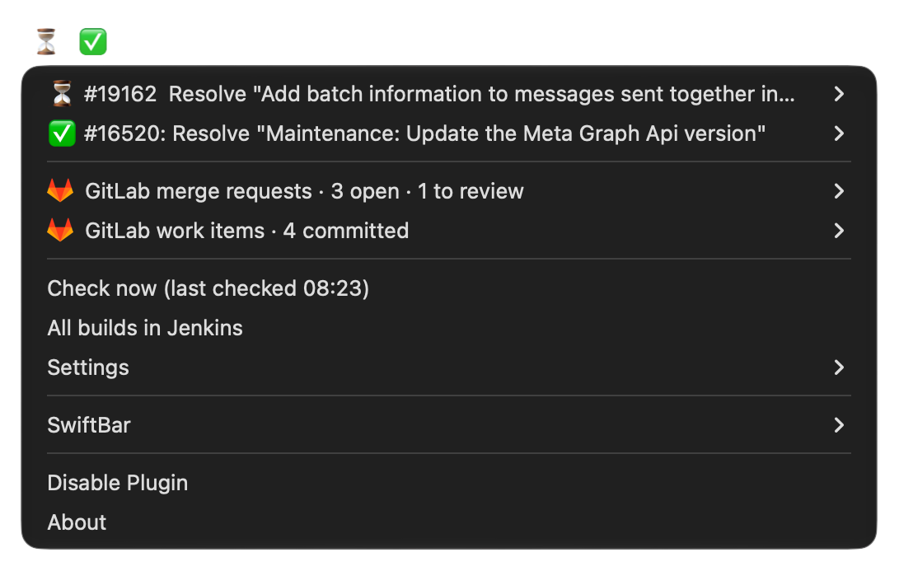
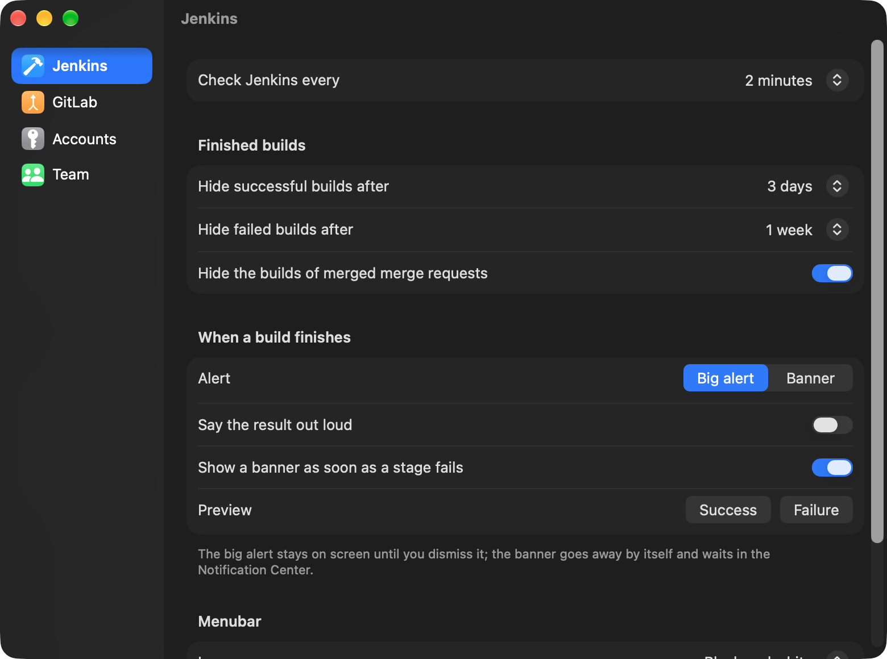

# Jenkins & GitLab menubar

A macOS menubar menu (SwiftBar plugin) for a GitLab project that Jenkins builds with a multibranch job:

- **Your Jenkins MR pipelines** with live stage and ETA, and a big alert (or a banner) the moment one finishes
- **Your GitLab merge requests**: your own, review requested, reviewed, with approvals and pipeline state on hover
- **Your GitLab work items**: committed and not committed, with filters, label filters and sorting



## Install

1. Put this folder where it will stay (it runs from here).
2. Copy `config/team.example.conf` to `config/team.conf` and fill in your Jenkins job and GitLab project, or use the
   `team.conf` your team shares.
3. In Terminal: `./install.sh`
   It installs jq and SwiftBar through Homebrew if missing, needs the Xcode Command Line Tools
   (`xcode-select --install`) and makes SwiftBar start at login.
4. Add the two tokens if the script says they are missing: in the menu, **Settings… → Accounts** stores them in the
   login keychain and checks that Jenkins and GitLab take them. Plain exports in `~/.zshrc` work too:
   - `export JENKINS_MCP_BASIC_AUTH=<base64 of jenkins-user:api-token>`
   - `export GITLAB_TOKEN=<GitLab token with the read_api scope>`

   A `~/.zshrc` that computes them (like `$(security …)`) does not, since the menu cannot run it: use Accounts instead,
   or put them in the keychain yourself (each command asks for the value):
   ```
   security add-generic-password -U -s jenkins-menubar -a JENKINS_MCP_BASIC_AUTH -w
   security add-generic-password -U -s jenkins-menubar -a GITLAB_TOKEN -w
   ```
5. Click **Allow** when macOS asks whether "Jenkins" may send notifications.

**Settings…** in the menu opens the settings window: **Jenkins** (checking, hiding, alerts), **GitLab** (checking, the
work item filters and labels; the work items submenu's **Filters…** opens it too), **Accounts** (the tokens) and
**Team** (`config/team.conf`). It writes `config/settings` and `config/team.conf`, which you can also edit by hand.



`jenkins-watch <MR number | build URL>` watches someone else's build from the terminal; `jenkins-watch --help` for more.

## What is where

| What | Where |
| --- | --- |
| SwiftBar plugin | `plugins/jenkins.30s.sh`, SwiftBar's plugin folder (or linked into yours) |
| Alert script | `bin/jenkins-watch`, linked as `~/bin/jenkins-watch` |
| App for the banners and the settings window | `notifier/Jenkins Watch.app`, built from `notifier/*.swift` |
| Tests | `tests/`, run with `tests/run.sh` |
| Icons | `icons/`: the app icon is `AppIcon.icon` (edit it in Icon Composer), `app.png` is its flat version for builds without Xcode |
| README screenshots | `docs/` |
| Team configuration (Jenkins, GitLab, label conventions) | `config/team.conf`, not committed |
| Your settings | `config/settings`, created on the first run, not committed |
| Cache | `~/Library/Caches/jenkins-menubar/` |

## Tests

`tests/run.sh` runs the tests of the plugin and of `jenkins-watch`; `tests/run.sh stage` only those with "stage" in
their name. They need nothing but jq: each test runs a copy of the tool in a temporary folder, with a fake curl that
answers like Jenkins and GitLab, and fakes for the sounds, dialogs, banners and the keychain.

The settings window has no tests of its own: it keeps no logic, the plugin answers it (`--settings-json`,
`--check-accounts`) and makes every change (`--set`, `--set-team`, `--label-filter`, `--set-token`, …), and the tests
cover those. After changing `notifier/*.swift`, rebuild the app with `notifier/build.sh`.

## License and credits

The code is MIT licensed, see [LICENSE](LICENSE).

The Jenkins icons in `icons/` (`AppIcon.icon` and `app.png` for the app, `happy.png` and `sad.png` for the alert) are
AI-generated images of the Jenkins mascot. The mascot is the [Jenkins logo](https://www.jenkins.io/artwork/) by Charles Lowell and Frontside,
licensed under [CC BY-SA 3.0](https://creativecommons.org/licenses/by-sa/3.0/), and the icons keep that license.
The GitLab logo is a trademark of GitLab Inc.
