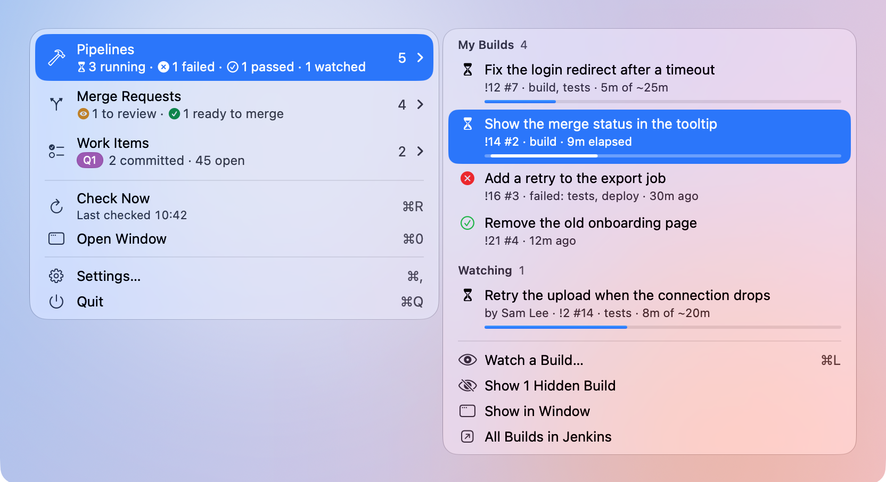
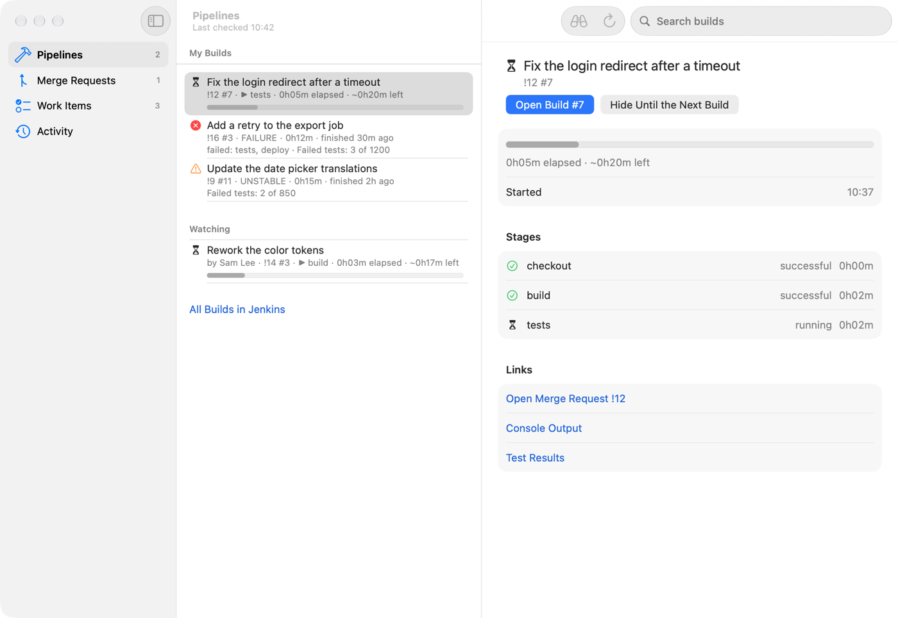

# MegaMonitor

A native macOS menu bar app for a GitLab project that Jenkins builds with a multibranch job. It shows your builds,
merge requests, work items, checkouts and release slots, and tells you the moment a build finishes.





## Install

It needs macOS 26 and the Xcode Command Line Tools (`xcode-select --install`); nothing else, no Xcode and no Homebrew.

1. Put this folder where it will stay: the app remembers it, to update itself from it.
2. In Terminal: `./install.sh`. It builds the app into `~/Applications/MegaMonitor.app` and opens it. (The app was called menubar-monitor before; the first install moves
   it over, keeps your settings and tokens, and keeps open at login on if it was on.)
3. The welcome flow takes it from there: what it imported from the old tool (see below), your team values (the Jenkins
   job, the GitLab URL and project), the two tokens, the notification permission, and whether to start at login.

`./install.sh --dry-run` prints what would change and changes nothing.

For the team values, **Settings → Projects** can import and export a file without tokens: see `team.example.json`. The
tokens go into the login keychain, **Settings → Accounts** checks that Jenkins and GitLab take them. Jenkins needs your
user and an API token, GitLab a token with the `api` scope (`read_api` is enough to read, but Re-request Review writes).

### Update

When the checkout changes (after a `git pull`, say), the app notices and offers **Update Ready — Rebuild** in the
window's toolbar. One click runs `build.sh --install`, opens the new app and quits the old one.
Nothing is rebuilt without that click.

## What it does

- **Menu bar icon and pane**: the icon counts your running, failed, unstable and successful builds, and marks
  problems. Its glass pane is a short overview: one row each for Pipelines, Merge Requests and Work Items, with counts
  and a summary. Hover a row (or press →) and a flyout beside the pane lists the items; a click opens one in Jenkins or
  GitLab, and its menu has **Show in Window**. **Check Now**, **Open Window**, Settings and Quit sit at the bottom.
- **Global hotkey**: Settings → General can set a shortcut that opens the main window from any app (and hides it
  again). Off by default.
- **Alerts**: a big alert window or a banner (your choice) when a build you follow finishes, and optionally a banner
  when a stage fails while the build goes on. **Rebuild** starts a finished build again with the same parameters, in
  one click; **Open Console** and **Hide Until the Next Build** are in the alert's menu and on the banner.
- **Main window** (⌘0, sections with ⌘1 to ⌘6):
  - **Pipelines**: your builds and the ones you watch, with stages, failed tests and links. A failed build shows its
    failed test names, and a stage that passed on the same commit is marked **likely flaky**.
  - **Merge Requests**: yours, review requested and reviewed, each with a status badge in GitLab's colors and its
    description. The details show the approvals and their rules, the unresolved threads, and the GitLab pipeline with
    its jobs. **Re-request Review** (↻) asks a reviewer again, or all the ones whose review is older than your last push.
  - **Work Items**: committed and not committed, with filters and label filters, and their related merge requests.
    **New Work Item…** (⌘N), **New Bug from This Build** and **New Follow-Up Item** open GitLab's own new issue page,
    prefilled, in the browser.
  - **Activity**: a log of every request, build, alert and problem, with search, filters and a chart of the check times.
    No token is ever kept in it.
  - **Workspaces**: your local checkouts, found in the folders of Settings → Repositories, with their branch, state and
    the merge request or work item behind them. Open one in your IDE (your own command), in Terminal or in Finder.
    The app only reads git; the one write is **Start Work Here** on a clean checkout of its base branch: it fetches,
    then creates the branch named after a work item, after you confirm. A local branch without a merge request offers
    **Create Merge Request**. Terminal opens in the default terminal, or the one you pick in Repositories.
  - **Slots**: the release slots of your work items (labels like `2026.51`), with their release, code freeze and early
    access dates computed from the slot's name, a countdown, and the committed items with the state of their merge
    requests and builds, flagged where they are at risk. It is growing into a full slot planning view. An optional
    banner warns before a code freeze.
- **Watch a Build…** (⌘L) takes a Jenkins build link (of a merge request or of a branch like `develop`), a GitLab merge
  request link or `!123`, and follows all its builds, the next ones too. A merge request's detail has **Watch Builds**
  for the same. Watched builds alert and hide like yours.
- **Several projects**: Settings → Projects adds more Jenkins jobs (same Jenkins and GitLab, same tokens). One check
  covers all of them, the counts are summed, and with more than one project the rows, alerts and the log name theirs.
- **Claude** (optional, off by default, needs Claude Code installed): with **Use Claude** on in Settings → General,
  a failed build gets **Why Did It Fail?** (a verdict, the root cause with its evidence, suspect commits, a next step),
  a merge request or work item gets **Summarize Discussion**, the window gets a **Digest**, and **Open in Claude Code**
  starts it in a checkout. It runs your own Claude Code login, sends only what you click (the first answer of each kind
  shows what goes), removes tokens and keys first, and stops at a monthly cap you set ($10 by default).
- **Easter eggs**: the butler sometimes has something to say. One switch in Settings → General turns them off.
- **Settings** (⌘,): General, Jenkins, GitLab, Repositories, Projects and Accounts.
- Jenkins is checked all the time; merge requests and work items load while you look at them, plus a few small
  background requests.

## Coming from jenkins-menubar

The first start imports what the old tool (a SwiftBar plugin with `jenkins-watch`) had: the tokens, the settings, the
team values, and the watched and hidden builds. It imports once, and the old tool keeps working next to it, so you can
compare. Some things can't move, and the welcome flow lists them: the notification permission (macOS keeps it per
app), keychain items made outside `security` (macOS asks once for access), window positions, and the caches.

When you are happy with the new app, remove the old tool:

```
./install.sh --retire-old
```

It unlinks the old SwiftBar plugin, removes SwiftBar from the login items (unless other plugins still need it), removes
the `jenkins-watch` link, unregisters the old helper app and, after a yes, deletes the old caches, logs and keychain
items. It leaves SwiftBar and jq installed and tells you what else is yours to clean up. Add `--dry-run` to see it first.

## Development

The visible name is MegaMonitor; the identity stays `menubar-monitor` (bundle id `local.menubar-monitor`, the
`menubar-monitor://` links, the keychain service, the folders in `~/Library`, the SwiftPM product and the module names),
so a rename never costs anyone their settings or tokens.

```
./build.sh [--debug] [--install]   # builds build/MegaMonitor.app
./test.sh [filter]                 # the Swift Testing tests
scripts/smoke.sh                   # runs the built app once against a local stub server
scripts/gallery-shots.sh all       # screenshots of the design gallery (not committed)
```

Everything builds with only the Command Line Tools, which limits the Swift in use. Swift 6, and no macro that needs
Xcode: views use `@ViewState` instead of `@State` (since the macOS 27 SDK, `@State` is a macro that only compiles with
Xcode), and `build.sh` refuses `@State`, `#Preview`, `@Entry`, `#Predicate`, SwiftData and the like.

- `Sources/MenubarCore`: models, stores, the Jenkins and GitLab clients, scheduling, alerts rules, import. No AppKit or
  SwiftUI.
- `Sources/MenubarUI`: the SwiftUI views (menu bar pane, main window, settings, welcome flow, alert) and the design gallery.
- `Sources/MenubarMonitor`: the app itself: the entry point, the system effects (notifications, keychain, login item)
  and the smoke check.

The debug build has a design gallery (`MegaMonitor --gallery`) that shows every screen with fixtures, in each
appearance, without touching real data. The repository is public, and `scripts/check-names.sh` (run by `build.sh`)
keeps a company name out of its files.

## License and credits

The code is MIT licensed, see [LICENSE](LICENSE).

The Jenkins icons in `icons/` (`AppIcon.icon` and `app.png` for the app, `happy.png` and `sad.png` for the alert, `menubar.png` for the menu bar) are
AI-generated images of the Jenkins mascot. The mascot is the [Jenkins logo](https://www.jenkins.io/artwork/) by Charles Lowell and Frontside,
licensed under [CC BY-SA 3.0](https://creativecommons.org/licenses/by-sa/3.0/), and the icons keep that license.
The GitLab logo is a trademark of GitLab Inc.
